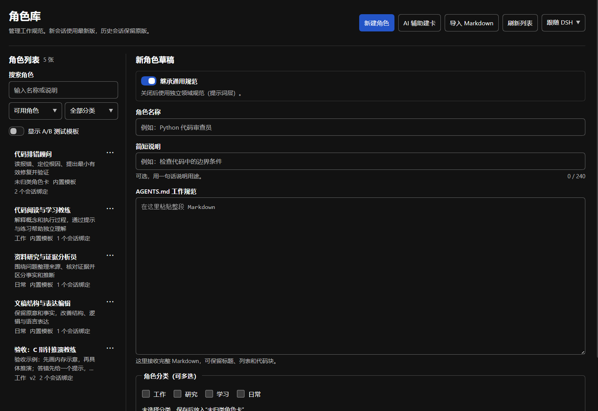
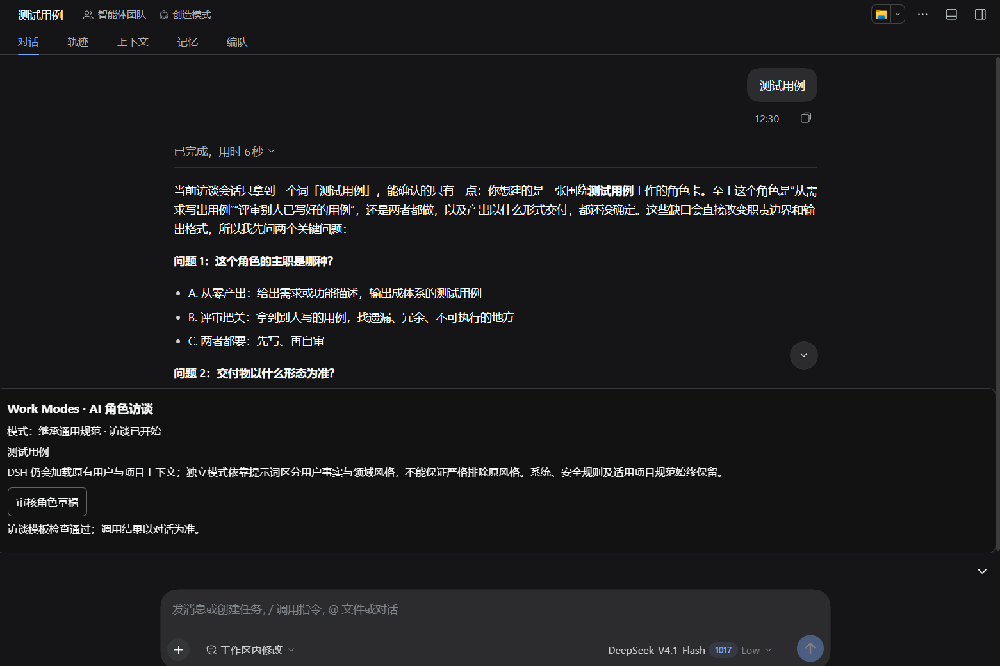
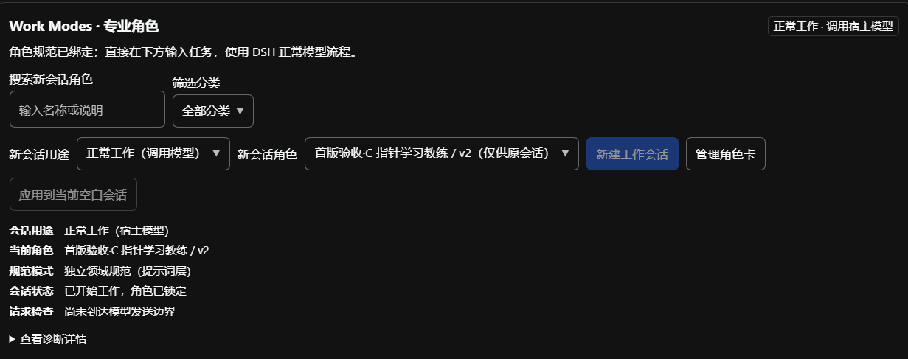

# DSH Work Modes

Work Modes 是 DeepSeek Harness（DSH）的原生插件。它管理 Markdown `AGENTS.md` 角色卡，让排错、学习、研究和写作等会话使用各自的职责、流程与输出要求。

当前版本为 **0.5.2**。版本记录见 [CHANGELOG](CHANGELOG.md)。

## 它怎样工作

**创建或导入角色卡 → 选择角色新建会话 → 开始工作后锁定 → 历史会话继续使用原版本。**

例如，为一张排错卡创建 v1 会话后，把角色卡更新到 v2。已有会话续聊时仍使用 v1，新建会话使用 v2。只修改分类时，正文版本保持原值。

| 功能 | 当前行为 |
| --- | --- |
| 角色库 | 新建、编辑、复制、查看历史版本、归档恢复、Markdown 导入导出 |
| AI 辅助建卡 | 需求访谈、草稿提取、人工修改、审核确认后入库 |
| 分类与搜索 | 工作、研究、学习、日常四类，可多选，并与关键词组合筛选 |
| 会话绑定 | 首次请求前加载规范，开始工作后锁定角色和版本 |
| 快捷操作 | 右键或行末菜单置顶，自定义卡支持可恢复删除 |
| 界面 | 默认跟随 DSH 主题，可选浅色或深色，并适应窄面板 |
| 本地验证 | 创建模拟回复会话，检查角色材料和绑定版本 |

## 快速开始

1. 从 [GitHub Releases](https://github.com/suxiangze4-png/dsh-work-modes/releases/tag/v0.5.2) 下载 `dsh-work-modes-probe-0.5.2.tgz`，按[安装说明](docs/INSTALLATION.md)装入 DSH 桌面端。
2. 打开 DSH 左侧「角色库」，选择「新建角色」。填写名称，把完整 Markdown 粘到「AGENTS.md 工作规范」，保存为 v1。
3. 打开一个 DSH 会话，点输入框上方的 **⌃** 展开 Work Modes。
4. 用途选择「正常工作（调用模型）」，选中角色并点击「新建工作会话」。
5. 核对角色名称与版本，在正常输入框发送任务。开始工作后，该会话的角色绑定锁定。

想让 AI 帮忙设计角色，可在角色库进入「AI 辅助建卡」。生成草稿后，先审核再确认保存。完整步骤见[使用指南](docs/USER_GUIDE.md)。

## 默认角色

| 角色 | 适用任务 |
| --- | --- |
| 代码排错顾问 | 阅读报错、定位根因、提出修复与验证方法 |
| 代码阅读与学习教练 | 解释概念和执行过程，通过提示与练习帮助理解 |
| 资料研究与证据分析员 | 整理来源、核对证据、区分事实与推断 |
| 文稿结构与表达编辑 | 保留事实和原意，改善结构、逻辑与表达 |

默认卡正文只读，可复制为自己的角色。改编来源和第三方许可见[来源声明](THIRD_PARTY_NOTICES.md)。

## 界面预览

### 角色库与手动建卡

左侧按关键词和分类查找角色，右侧设置继承模式并编辑 Markdown 工作规范。

### AI 需求访谈

输入「测试用例」后，AI 追问角色是负责编写、评审，还是两者都做，并询问交付格式。

### 工作会话的角色绑定

此会话已锁定在 v2。角色归档后仍可供原会话使用。

## 兼容与验证

下表记录 **2026-11-24** 对 0.5.2 的验证结果，兼容声明按受测版本列出。

| DSH 版本 | 集成测试 | 桌面验证 |
| --- | --- | --- |
| 0.2.1-rc.2 | 57 / 57 通过 | 沿用既有桌面记录 |
| 0.2.2-rc.1 | 57 / 57 通过 | 沿用既有桌面记录 |
| 0.2.2-rc.5 | 57 / 57 通过 | 本轮验证覆盖集成测试 |
| 0.2.3-alpha.2 | 57 / 57 通过 | Windows x64 建卡、访谈审核、工作会话和冷启动恢复通过 |

集成测试使用官方运行包与 Mock 模型。新版桌面验收经过完整宿主请求流程，由隔离的模拟适配器响应。真实模型的输出质量仍需按具体任务评估。复现方法和验证范围见[开发与验证说明](docs/DEVELOPMENT.md)。

## 使用前了解

- 「继承通用规范」开关关闭后，使用提示词层的独立领域规范。DSH 仍加载适用的原生用户与项目上下文。
- 正常工作和 AI 访谈走宿主配置的模型，可能产生模型用量。本地验证会话由插件返回模拟回复。
- 卸载保留用户角色和历史版本。继续使用受管会话时，需要先启用插件。

## 文档入口

- [安装、更新和卸载](docs/INSTALLATION.md)
- [使用指南与常见问题](docs/USER_GUIDE.md)
- [开发、数据结构与验证](docs/DEVELOPMENT.md)
- [版本记录](CHANGELOG.md)
- [第三方来源与许可](THIRD_PARTY_NOTICES.md)
